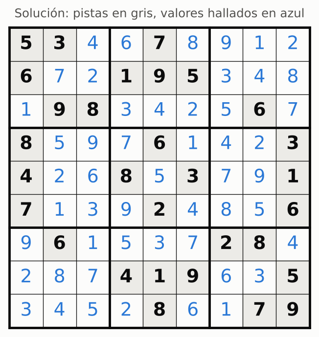
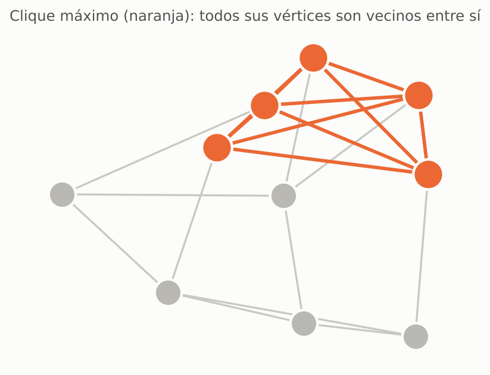
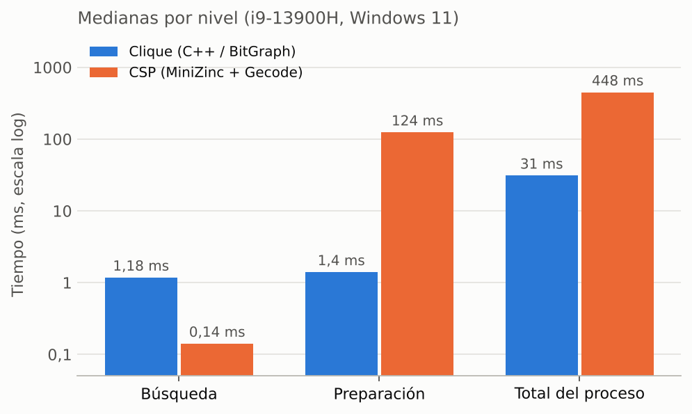

# Sudoku: CSP vs. máximo clique

Tarea de **Matemáticas para Automática y Robótica** (MUAR, ETSII-UPM).

Se resuelve el mismo Sudoku de dos formas y se comparan los tiempos en la misma máquina:

1. **CSP** con MiniZinc y el solver Gecode.
2. **Máximo clique** con un algoritmo propio de ramificación y poda en C++, usando la librería BitGraph 2.0.



## Contenido

| Archivo | Qué es |
|---|---|
| `Sudoku_oficial.mzn` | Modelo CSP de MiniZinc |
| `main.cpp` | Grafo, búsqueda del clique y medida de tiempos |
| `CMakeLists.txt` | Compilación del programa C++ |

## Idea del modelo de grafo

- **Vértices:** cada tripleta `(r, c, v)` significa "la casilla (r, c) tiene el valor v". Hay 9 · 9 · 9 = 729.
- **Aristas:** unen vértices compatibles. No hay arista si están en la misma casilla o si repiten valor en la misma fila, columna o bloque.
- **Solución:** un clique de 81 vértices es un Sudoku resuelto, con un vértice por casilla y sin valores repetidos.



La búsqueda poda con una **cota por coloreado**: cada casilla es un color, y si `|C| + casillas(P) < 81` la rama no puede llegar a 81.

## Cómo ejecutarlo

**MiniZinc**
```bash
minizinc --solver gecode --statistics Sudoku_oficial.mzn
```

**C++** (necesita BitGraph 2.0 instalado; ajusta la ruta en `CMakeLists.txt`)
```bash
cmake -S . -B build -G Ninja -DCMAKE_BUILD_TYPE=Release
cmake --build build
./build/sudoku_clique
```

## Resultados

Medianas en un Intel Core i9-13900H con 16 GB de RAM y Windows 11:

| | Clique (C++) | CSP (MiniZinc) |
|---|---|---|
| Nodos explorados | 695 | 1 |
| Búsqueda | 1177 µs | 141 µs |
| Preparación | 1,4 ms | 124 ms |
| Total del proceso | 31 ms | 448 ms |



Gecode es unas 8 veces más rápido buscando, porque su propagación resuelve el Sudoku sin ramificar. El clique es unas 15 veces más rápido en total, porque MiniZinc invierte casi todo el tiempo en aplanar el modelo y arrancar el solver.

---
Gonzalo Parot Leon · Noviembre 2026
