# Algoritmos de búsqueda en laberintos

**BF · DF · Best First · A\* · IDDF**

Ejercicio evaluable de **Matemáticas para Automática y Robótica**
Máster en Automática y Robótica · ETSII-UPM · Octubre 2026


Programa en C++ que resuelve laberintos en cuadrícula con cinco algoritmos de búsqueda clásicos y compara su comportamiento: longitud del camino encontrado, nodos analizados y memoria utilizada (tamaño máximo de las listas OPEN y CLOSED). Se han probado 12 laberintos, entre ellos casos sin salida, un pasillo único, un espacio sin paredes y dos laberintos "trampa" pensados para engañar a la heurística.

---

## Índice

- [Contenido de la carpeta](#contenido-de-la-carpeta)
- [Compilación y ejecución](#compilación-y-ejecución)
- [Estructura del código](#estructura-del-código)
- [Los cinco algoritmos](#los-cinco-algoritmos)
- [Convenciones y métricas](#convenciones-y-métricas)
- [Validación con el enunciado](#validación-con-el-enunciado)
- [Resultados](#resultados)
- [Soluciones por laberinto](#soluciones-por-laberinto)
- [Análisis](#análisis)
- [Conclusiones](#conclusiones)
- [Uso de IA](#uso-de-ia)

---

## Contenido de la carpeta

```
laberinto/
├── README.md        Este documento
├── img/             Imágenes de las soluciones (una carpeta por laberinto)
│   ├── portada.png
│   ├── maze_1/      BF.png · DF.png · BestFirst.png · Aestrella.png · IDDF.png
│   └── ...
├── *.cpp            Código fuente
└── maze_*.txt       Los 12 laberintos de prueba
```

## Compilación y ejecución

**Entorno utilizado:** C++17, g++ 16.2 (MSYS2, UCRT64) y Visual Studio Code en Windows. También compila en Linux con cualquier g++ que soporte C++17.

```bash
g++ -std=c++17 -O2 -o laberinto laberinto.cpp
./laberinto
```

> Si el archivo fuente tiene otro nombre, cambia `laberinto.cpp` en el comando.

Al ejecutarlo aparece un menú para elegir uno de los 12 laberintos. Para guardar la salida en un archivo sin pasar por el menú:

```bash
echo N | ./laberinto > salida_N.txt     # N = número del laberinto en el menú
```

### Formato de los laberintos

Cada laberinto es un `.txt` con la cuadrícula codificada con números. La casilla de inicio **I** se marca con `4` y la meta **G** con `5`. La función `leerLaberinto()` lee el archivo y localiza ambas casillas.

## Estructura del código

| Elemento | Descripción |
|---|---|
| `struct celda` | Posición (fila, columna) en la cuadrícula |
| `struct Laberinto` | Matriz del laberinto, dimensiones y posiciones de I y G |
| `struct Nodo` | Nodo de búsqueda: celda, coste `g`, heurística `h` y profundidad |
| `struct Resultado` | Métricas de una ejecución: camino, nodos analizados, máx. OPEN y máx. CLOSED |
| `leerLaberinto()` | Lee el `.txt` y localiza I (4) y G (5) |
| `bf()` | Búsqueda en anchura |
| `df()` | Búsqueda en profundidad |
| `bestfirstf()` | Búsqueda primero el mejor (voraz) |
| `Aestrella()` | A\* |
| `iddf()` | Profundización iterativa |

Las cinco funciones comparten la lectura del laberinto, el cálculo de vecinos y la reconstrucción del camino, que se hace con una **matriz de padres**.

## Los cinco algoritmos

Todos siguen el mismo esquema. Lo único que cambia entre ellos es cómo se gestiona la lista **OPEN**:

1. `OPEN = {I}`
2. Se extrae un nodo de OPEN. Si es G, termina.
3. Si no, el nodo pasa a CLOSED y sus vecinos libres no visitados entran en OPEN.
4. Si OPEN se queda vacía, no hay solución.

| Algoritmo | Estructura de OPEN | Nodo que se extrae | ¿Camino más corto? |
|---|---|---|---|
| **BF** (anchura) | `queue` (FIFO) | El más antiguo | Sí |
| **DF** (profundidad) | `stack` (LIFO) | El más reciente | No |
| **Best First** | `priority_queue` | Menor h(n) | No |
| **A\*** | `priority_queue` | Menor f(n) = g(n) + h(n) | Sí (si h es admisible) |
| **IDDF** | `stack` + límite C = 0, 1, 2… | DF sin pasar de profundidad C | Sí |

## Convenciones y métricas

| Concepto | Definición |
|---|---|
| **Orden de vecinos** | Arriba, abajo, izquierda, derecha. En DF la pila invierte el orden, así que se prueba primero la derecha. |
| **Nodos analizados** | Nodos extraídos de OPEN, incluida la meta. Son los «pasos» del enunciado. |
| **Profundidad** | Longitud del camino en movimientos. Medida en casillas sería un valor más, porque se cuenta la I. |
| **Heurística** | Distancia Manhattan: h(n) = \|Δfila\| + \|Δcol\|. Es admisible porque, sin movimientos diagonales, nunca sobreestima. |
| **Máx. OPEN / CLOSED** | OPEN se mide tras expandir cada nodo. CLOSED es el número de nodos expandidos; en IDDF se toma el máximo por iteración. |
| **Sin solución** | OPEN se vacía. En IDDF, se alcanza una iteración en la que ningún nodo llega al límite. |

## Validación con el enunciado

`maze_1` es el laberinto de la diapositiva de ejemplo del enunciado, y sirve para comprobar el programa:

- **DF:** 114 nodos y 83 movimientos. El enunciado da 113 pasos y profundidad 84. Las cifras coinciden si no se cuenta la meta y se mide en casillas.
- **A\*:** camino de 69 movimientos, es decir, 70 casillas, igual que el enunciado.
- **BF:** el enunciado da profundidad 79 (> 70). Como un BF estándar siempre encuentra el camino mínimo, el del enunciado debe ser otra variante.

## Resultados

Formato de cada celda: **movimientos · nodos analizados**. En **negrita**, los caminos más largos que el óptimo.

| Laberinto | Tamaño | BF | DF | Best First | A\* | IDDF |
|---|---|---|---|---|---|---|
| maze_1 | 21 × 20 | 69 · 160 | **83** · 114 | **83** · 118 | 69 · 151 | 69 · 9 096 |
| maze_2 | 21 × 20 | 61 · 161 | **65** · 88 | **75** · 119 | 61 · 150 | 61 · 8 530 |
| maze_3 | 22 × 20 | 30 · 56 | **54** · 55 | **54** · 57 | 30 · 45 | 30 · 821 |
| maze_4 | 20 × 22 | 35 · 51 | 35 · 175 | 35 · 36 | 35 · 38 | 35 · 707 |
| maze_5 | 20 × 22 | 32 · 141 | **36** · 44 | **42** · 104 | 32 · 102 | 32 · 2 360 |
| maze_ejemplo | 21 × 20 | 63 · 166 | 63 · 154 | 63 · 100 | 63 · 124 | 63 · 4 330 |
| maze_horizontal | 21 × 20 | 162 · 163 | 162 · 163 | 162 · 163 | 162 · 163 | 162 · 13 366 |
| maze_libre | 21 × 20 | 35 · 308 | **163** · 164 | 35 · 36 | 35 · 207 | 35 · 24 634 |
| maze_noexit_small | — | sin sol. · 21 | sin sol. · 21 | sin sol. · 21 | sin sol. · 21 | sin sol. · 252 |
| maze_noexit | — | sin sol. · 178 | sin sol. · 178 | sin sol. · 178 | sin sol. · 178 | sin sol. · 21 396 |
| maze_trampa | 21 × 20 | 15 · 33 | **61** · 136 | 15 · 16 | 15 · 18 | 15 · 169 |
| maze_trampa2 | 21 × 20 | 32 · 186 | **54** · 107 | **42** · 51 | 32 · 81 | 32 · 4 549 |

### Memoria: máximo de OPEN / máximo de CLOSED

| Laberinto | BF | DF | Best First | A\* | IDDF |
|---|---|---|---|---|---|
| maze_1 | 6 / 159 | 15 / 113 | 10 / 117 | 8 / 150 | 13 / 158 |
| maze_2 | 10 / 160 | 13 / 87 | 11 / 118 | 12 / 149 | 12 / 159 |
| maze_3 | 3 / 55 | 3 / 54 | 3 / 56 | 3 / 44 | 2 / 55 |
| maze_4 | 6 / 50 | 25 / 174 | 7 / 35 | 6 / 37 | 7 / 49 |
| maze_5 | 8 / 140 | 22 / 43 | 17 / 103 | 11 / 101 | 21 / 138 |
| maze_ejemplo | 9 / 165 | 24 / 153 | 10 / 99 | 12 / 123 | 15 / 158 |
| maze_horizontal | 1 / 162 | 1 / 162 | 1 / 162 | 1 / 162 | 1 / 162 |
| maze_libre | 18 / 307 | 145 / 163 | 33 / 35 | 100 / 206 | 33 / 307 |
| maze_noexit_small | 1 / 21 | 1 / 21 | 1 / 21 | 1 / 21 | 1 / 21 |
| maze_noexit | 6 / 178 | 14 / 178 | 6 / 178 | 6 / 178 | 14 / 178 |
| maze_trampa | 10 / 32 | 31 / 135 | 6 / 15 | 8 / 17 | 7 / 28 |
| maze_trampa2 | 13 / 185 | 34 / 106 | 30 / 50 | 26 / 80 | 19 / 177 |

## Soluciones por laberinto

Leyenda: gris oscuro = pared · blanco = libre · verde = camino · naranja = inicio I · rojo = meta G.

| Laberinto | BF | DF | Best First | A\* | IDDF |
|---|---|---|---|---|---|
| maze_1 | 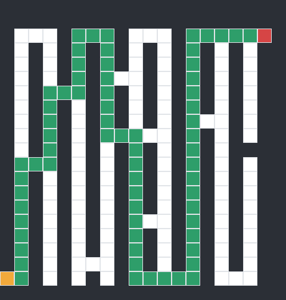 | 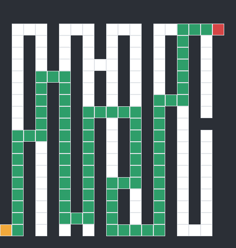 | 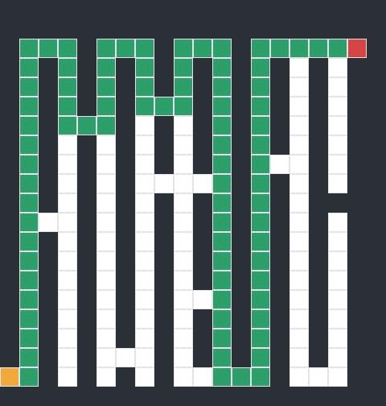 | 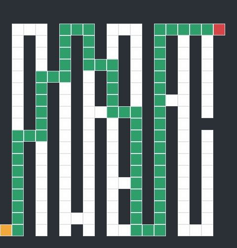 | 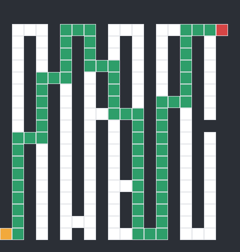 |
| maze_2 | 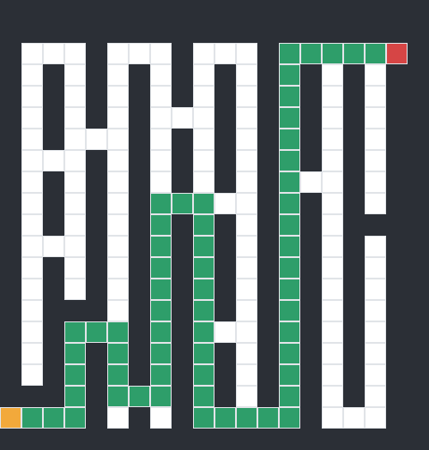 | 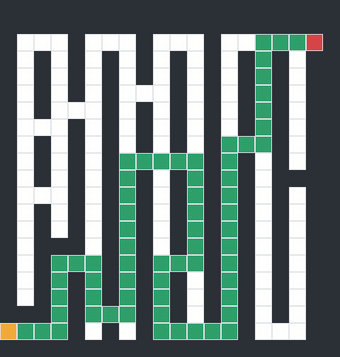 | 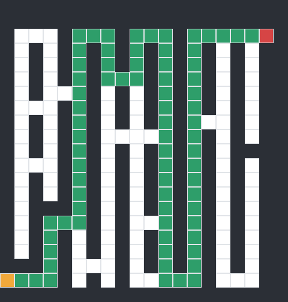 | 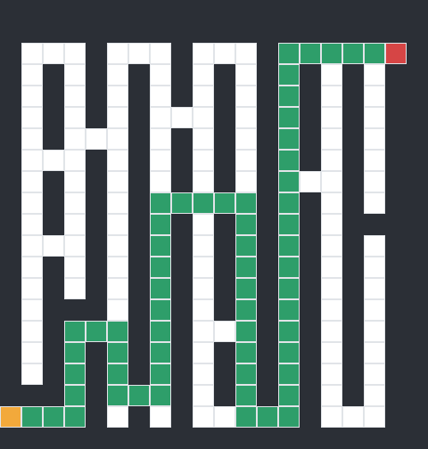 | 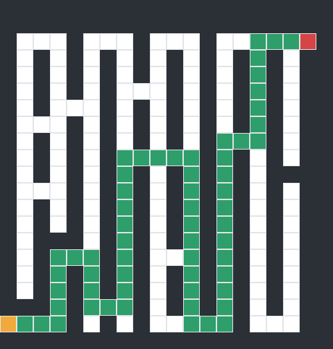 |
| maze_3 |  |  | 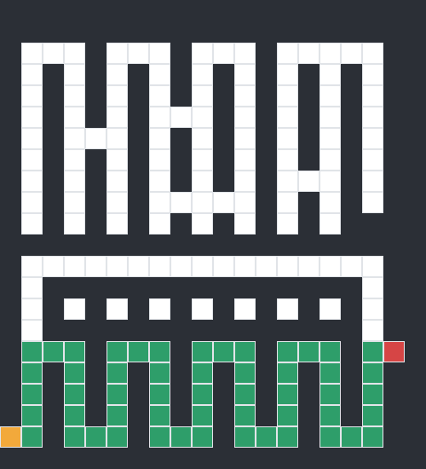 | 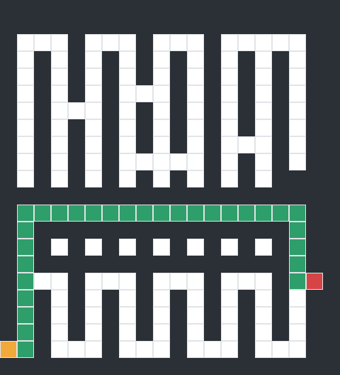 |  |
| maze_4 |  | 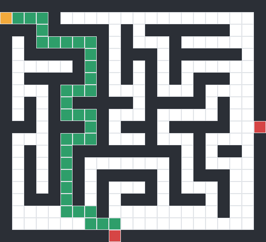 | 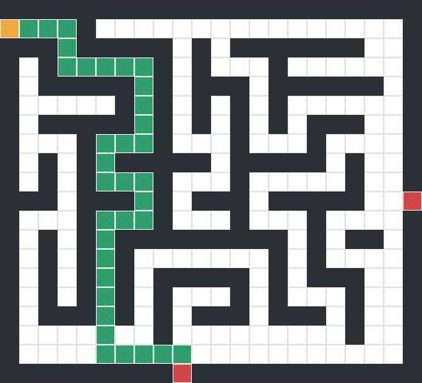 |  |  |
| maze_5 | 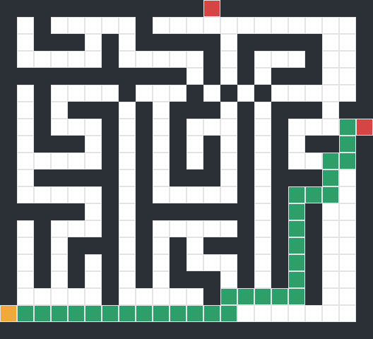 | 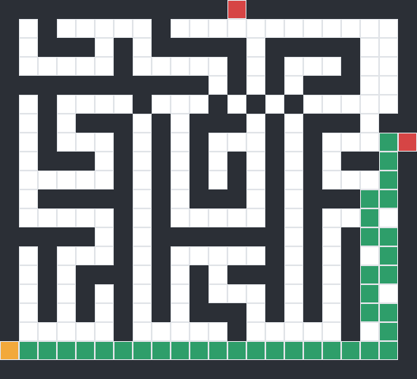 | 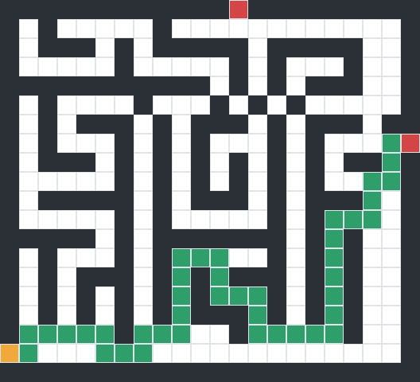 | 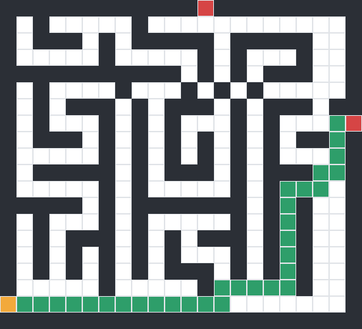 | 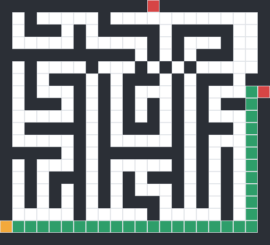 |
| maze_ejemplo | 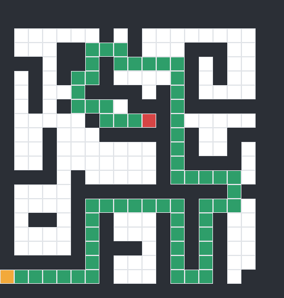 |  | 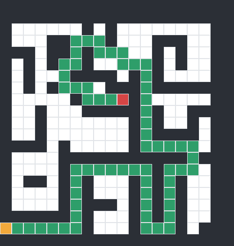 | 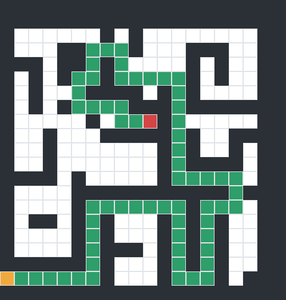 |  |
| maze_horizontal |  |  | 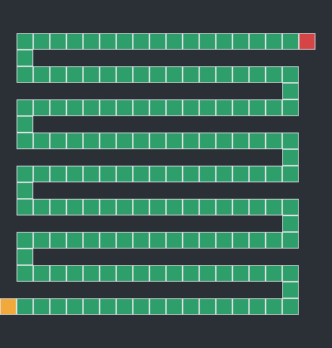 |  |  |
| maze_libre | 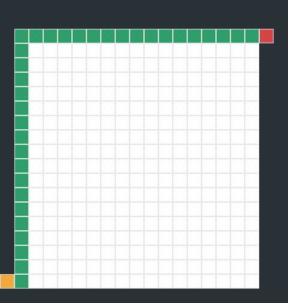 | 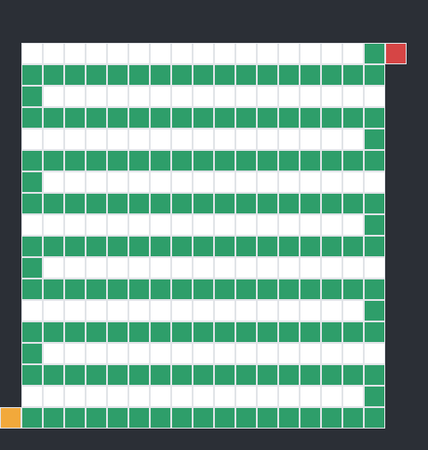 |  | 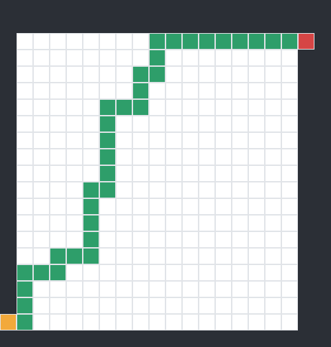 | 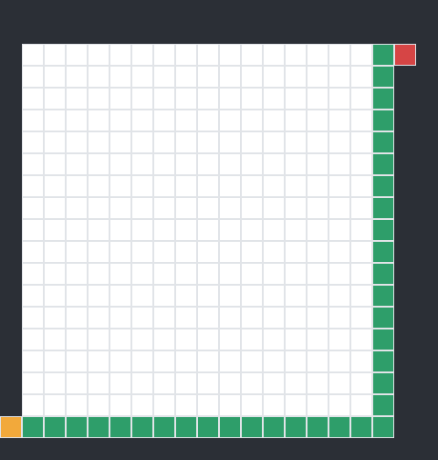 |
| maze_trampa | 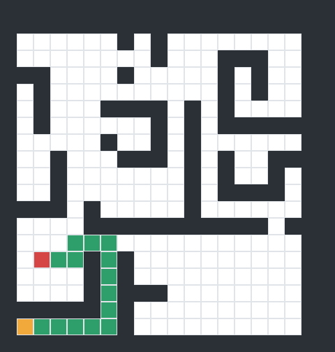 | 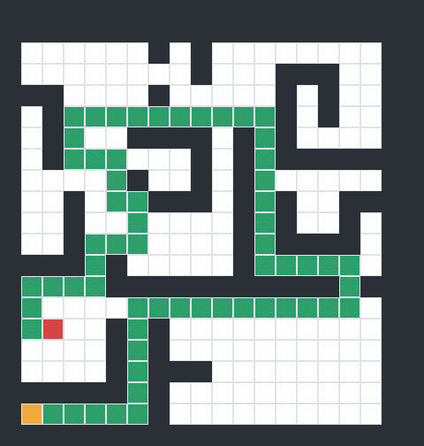 |  |  | 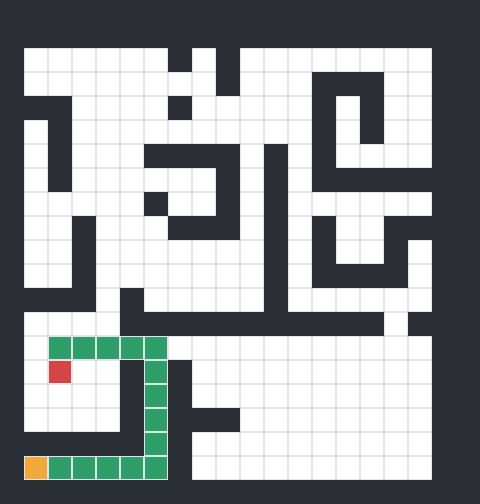 |
| maze_trampa2 | 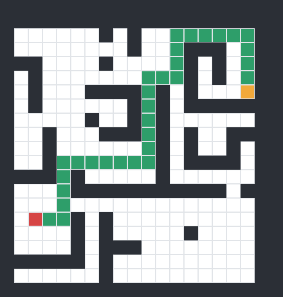 | 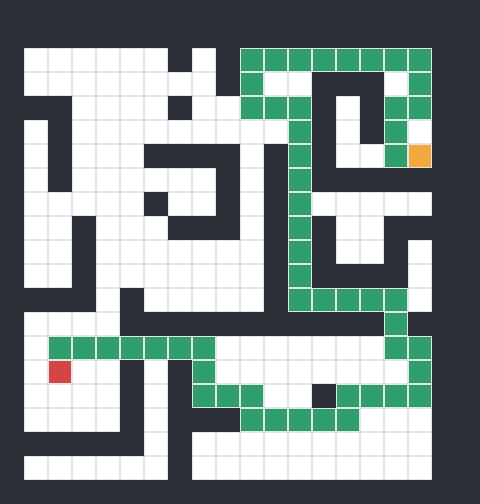 | 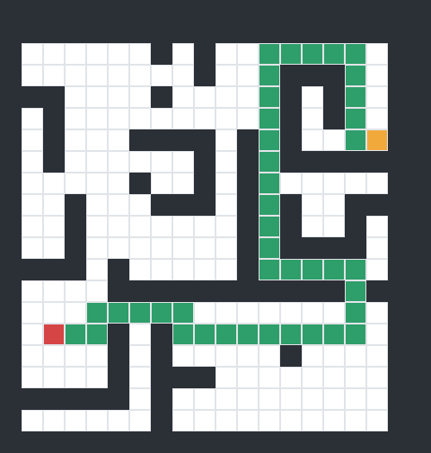 | 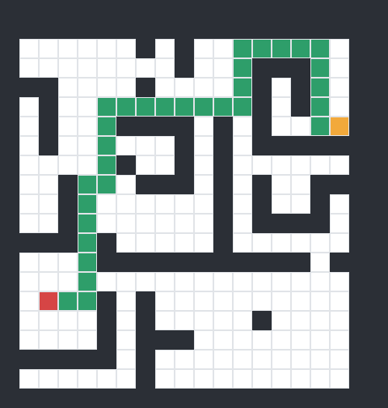 | 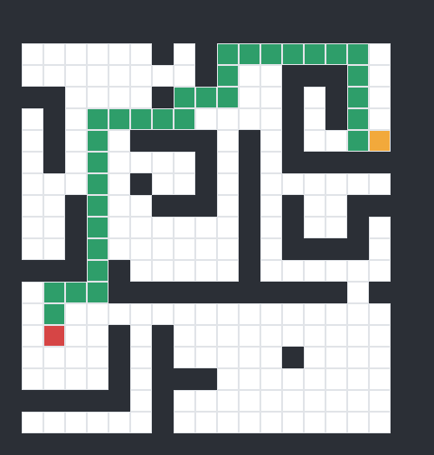 |

`maze_noexit_small` y `maze_noexit` no tienen imagen porque no hay camino que dibujar.

### Observaciones por laberinto

- **maze_1:** BF, A\* e IDDF encuentran el óptimo (69 movimientos). DF y Best First dan 83. A\* analiza menos nodos que BF (151 frente a 160).
- **maze_2:** el óptimo es 61. DF analiza menos nodos (88), pero su camino es más largo (65). Best First da el peor camino (75).
- **maze_3:** la heurística engaña a Best First, que baja en zigzag por el pasillo inferior (54). A\* es el que menos nodos analiza (45).
- **maze_4:** todos encuentran el óptimo (35). Best First y A\* van casi directos (36 y 38 nodos); DF necesita 175.
- **maze_5:** DF analiza solo 44 nodos, pero no es óptimo (36). Best First da el camino más largo (42) y A\* llega al óptimo con 102 nodos.
- **maze_ejemplo:** los cinco dan 63 movimientos. Best First es el más eficiente (100 nodos), seguido de A\* (124).
- **maze_horizontal:** es un único pasillo, así que BF, DF, Best First y A\* hacen exactamente lo mismo (163 nodos, OPEN = 1). IDDF repite el recorrido con cada límite: 13 366 nodos.
- **maze_libre:** sin paredes, la heurística es perfecta y Best First lo resuelve con 36 nodos. DF da 163 movimientos y llena OPEN (145). A\* sufre empates en f y analiza 207 nodos.
- **maze_noexit_small:** sin solución. Los cinco exploran las 21 casillas alcanzables desde I antes de rendirse; IDDF repite la exploración (252 nodos).
- **maze_noexit:** sin solución y sin G en el archivo. Los cinco recorren las 178 casillas alcanzables; IDDF necesita 21 396 nodos.
- **maze_trampa:** Best First no cae en la trampa (16 nodos y camino óptimo). DF se aleja por la parte superior y da 61 movimientos.
- **maze_trampa2:** aquí la heurística sí engaña a Best First (42 frente a 32). A\* corrige gracias a g y llega al óptimo con 81 nodos.

## Análisis

### ¿Quién encuentra el camino más corto?

Se cuentan los 10 laberintos con solución.

| Algoritmo | Óptimo en | Comentario |
|---|---|---|
| BF, A\*, IDDF | 10 / 10 | Óptimos siempre, como predice la teoría |
| Best First | 5 / 10 | Falla en maze_1, 2, 3, 5 y trampa2: solo mira lo que falta (h), no lo recorrido (g) |
| DF | 3 / 10 | Falla en siete laberintos; en maze_libre da 163 movimientos frente a 35 |

**Por qué A\* acierta y Best First no.** Los dos usan la distancia Manhattan, pero A\* ordena por g + h. Como h es admisible (nunca sobreestima), A\* no puede cerrar la meta por un camino más largo. Best First sigue cualquier pasillo que «parezca» acercarse, aunque luego tenga que rodear.

### ¿Cuánto trabajo cuesta cada uno?

- **A\* ≤ BF en nodos.** En los 10 laberintos con solución, A\* analiza menos nodos que BF (en el pasillo único, los mismos).
- **Best First es el más rápido** cuando la heurística acierta (maze_4, libre, trampa): llega casi sin desviarse.
- **IDDF analiza entre 5 y 82 veces más nodos que BF.** Encuentra el mismo camino óptimo, pero repite toda la búsqueda con cada nuevo límite.

### Memoria y casos especiales

- **Máx. OPEN:** en pasillos estrechos la frontera de BF es pequeña (de 1 a 18). DF la dispara en espacios abiertos: 145 en maze_libre. En A\* cuentan también las copias repetidas de una casilla cuyo coste ha mejorado.
- **IDDF y memoria:** su OPEN se parece a la de DF (de 1 a 33). Su ventaja teórica frente a BF aparece con factores de ramificación altos; en estos laberintos, casi todo pasillos, apenas se nota.
- **Laberintos sin salida:** ningún algoritmo puede ahorrar trabajo, porque todos recorren la zona alcanzable entera (21 y 178 casillas). La heurística no orienta porque no hay G.
- **Laberintos trampa:** en maze_trampa la G está cerca y Best First acierta (16 nodos). En trampa2 la heurística engaña y Best First da 42 movimientos frente a 32.

## Conclusiones

| Algoritmo | Valoración |
|---|---|
| **A\*** | La mejor opción general: siempre óptimo y nunca analiza más nodos que BF. |
| **BF** | Óptimo y predecible, pero explora en ondas sin orientación. |
| **Best First** | El más rápido cuando la heurística acierta, sin garantía de camino óptimo. |
| **DF** | Coste y longitud imprevisibles; depende del orden de los vecinos. |
| **IDDF** | Óptimo con poca memoria, a cambio de repetir mucho trabajo. |

## Uso de IA

Se usó Claude (Anthropic) como apoyo para repasar C++, entender los algoritmos y depurar errores:

- BF, DF, Best First y A\* se escribieron y depuraron paso a paso con su guía.
- IDDF parte de una versión propuesta por la IA, que después se revisó y adaptó.
- Las imágenes de las soluciones se generaron a partir de la salida del programa.

---

*Gonzalo · Máster en Automática y Robótica, ETSII-UPM*
